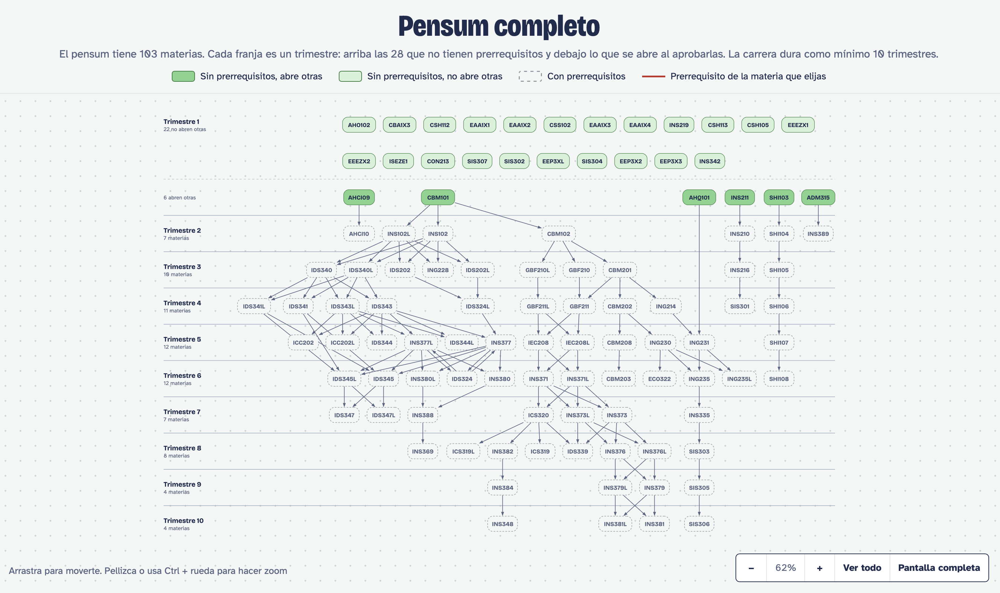
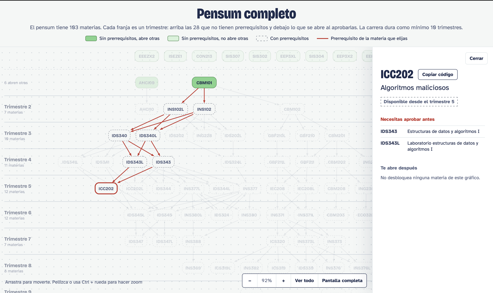

# Sistema de gestión de pensum

Programa de consola para consultar el pensum de Ingeniería de Sistemas (SIS-2020): prerrequisitos,
materias que se desbloquean al aprobar otra y materias pendientes. Genera gráficos interactivos
en HTML, organizados por trimestres, que se abren en el navegador.

## Capturas

Pensum completo por trimestres. Arriba están las materias sin prerrequisitos y en cada franja lo que
se desbloquea al aprobar las anteriores:



Al hacer clic en una materia se resalta en rojo su cadena de prerrequisitos. El panel lateral muestra
su nombre, desde qué trimestre se puede inscribir, qué hay que aprobar antes y qué materias abre:



## Requisitos

- Python 3.10 o superior
- [Graphviz](https://graphviz.org/download/) instalado en el sistema (el programa `dot`)
- El paquete de Python `graphviz` (se instala desde `requirements.txt`)

El paquete de Python solo conecta con Graphviz; sin el programa del sistema los gráficos fallan.

### Instalar Graphviz

| Sistema | Comando |
|---|---|
| macOS | `brew install graphviz` |
| Ubuntu / Debian | `sudo apt install graphviz` |
| Windows | `winget install graphviz` y agregar su carpeta `bin` al `PATH` |

Comprueba la instalación con `dot -V`.

## Instalación

```bash
python3 -m venv .venv
source .venv/bin/activate        # En Windows: .venv\Scripts\activate
pip install -r requirements.txt
```

## Uso

```bash
python3 main.py
```

Menú:

1. Ver el pensum completo y, si quieres, su gráfico por trimestres
2. Prerrequisitos directos de una materia
3. Todos los prerrequisitos (directos e indirectos), con gráfico
4. Dependientes directos de una materia
5. Dependientes directos e indirectos, con gráfico
6. Materias sin cursar: cuáles puedes inscribir ya y cuáles siguen bloqueadas
7. Limpiar la consola
8. Salir

Los gráficos se guardan en `graficos/` (`.svg` y `.html`) y se abren solos en el navegador.

## Archivos de datos

`pensum.txt` contiene todas las materias, y `sin_cursar.txt` contiene las que te faltan. Los dos usan
el mismo formato, una materia por línea:

```
CODIGO: NOMBRE DE LA MATERIA: PRERREQUISITO1, PRERREQUISITO2
```

Si la materia no tiene prerrequisitos, deja vacío lo que va después de los últimos dos puntos:

```
CBM101: ALGEBRA Y GEOMETRIA ANALITICA:
CBM208: ALGEBRA LINEAL: CBM202
```

Para actualizar tu avance, quita de `sin_cursar.txt` las materias que ya aprobaste.

## Estructura

```
main.py           Programa principal: lectura del pensum, grafo y menú
plantilla.html    Plantilla de los gráficos interactivos
estilos.css       Estilos de la plantilla (se copia a graficos/)
pensum.txt        Pensum completo
sin_cursar.txt    Materias pendientes
graficos/         Gráficos generados (no se sube al repositorio)
```
